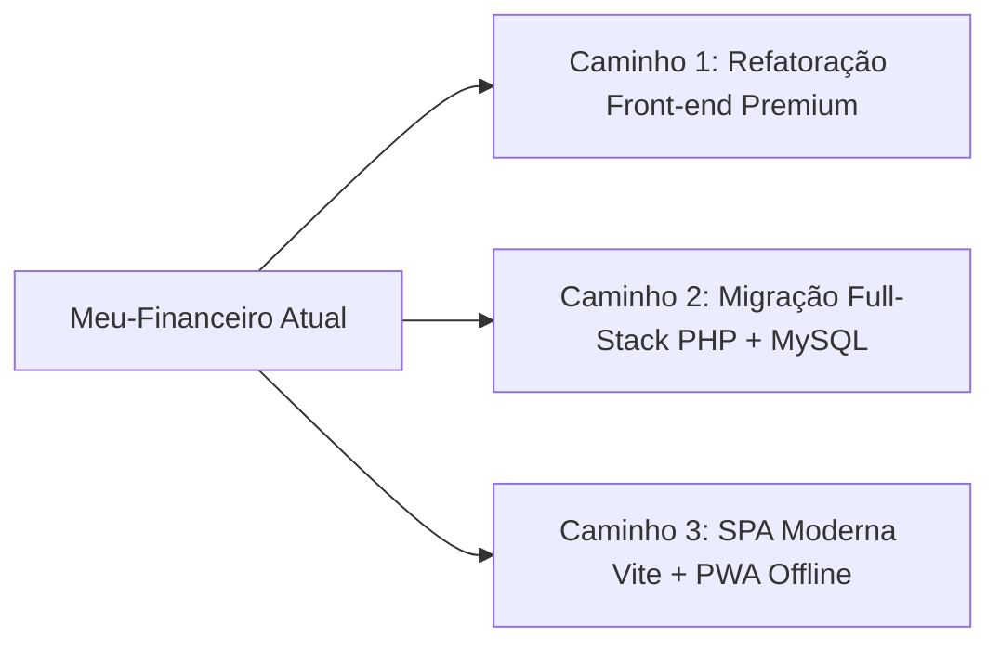

# Plano de Análise Técnica e Evolução: Meu-Financeiro

## Visão Geral do Projeto

O **Meu-Financeiro** é uma aplicação web *Single-Page Application* (SPA) voltada para o controle financeiro pessoal. O sistema foi concebido para operar **100% no lado do cliente (client-side)**, sem dependência obrigatória de back-end ou banco de dados externo, armazenando os dados no navegador do usuário (`localStorage`).

```mermaid
graph TD
    User([Usuário]) --> UI[Interface Web - index.html]
    UI --> State[Estado em Memória: transacoes[]]
    State <--> LocalStorage[Navegador LocalStorage: financas_app_dados]
    UI --> ChartJS[Chart.js: Gráfico de Rosca]
    UI --> HTML2PDF[html2pdf.js: Exportador de PDF]
    UI --> BackupJSON[Importação / Exportação JSON]
```

### Ficha Técnica
- **Localização:** `c:\xampp\htdocs\Estudos_PHP\Projetos\Meu-Financeiro`
- **Arquitetura atual:** Monolito em arquivo único ([index.html](file:///c:/xampp/htdocs/Estudos_PHP/Projetos/Meu-Financeiro/index.html) com ~940 linhas).
- **Linguagens e Bibliotecas:**
  - HTML5 & JavaScript Vanilla (ES6+)
  - **Tailwind CSS** (via Play CDN `cdn.tailwindcss.com`)
  - **Chart.js** (via CDN jsDelivr)
  - **html2pdf.js** (via cdnjs)
- **Persistência:** `localStorage` sob a chave `'financas_app_dados'`.

---

## Mapeamento Funcional Detalhado

### 1. Gestão de Estado e Persistência
- **Array Global `transacoes`:** Vetor em memória carregado na inicialização via `JSON.parse(localStorage.getItem('financas_app_dados')) || []`.
- **Sincronização:** Todas as alterações invocam `salvarEAtualizar()`, que persiste em JSON e dispara `renderizarInterface()`.
- **Backup & Restauração:**
  - `exportarBackup()`: Serializa o estado em arquivo `financas_backup_YYYY-MM-DD.json`.
  - `importarBackup(event)`: Lê arquivo JSON externo via `FileReader` e oferece opção de **Substituir** todos os dados ou **Mesclar** (evitando IDs duplicados via `Set`).
  - `limparTudo()`: Zera completamente os registros após confirmação do usuário.

### 2. Motor de Lançamento de Transações
O formulário suporta 3 modalidades distintas de movimentação (`frequencia`):
- **Pagamento Único (`unico`):** Insere um único registro com ID baseado em timestamp.
- **Programado / Parcelado (`parcelado`):**
  - Solicita o número de parcelas (2 a 72).
  - Rateia o valor total (`valorTotal / parcelas`).
  - Gera $N$ transações em meses consecutivos com identificador comum `groupId: Date.now()`, nomeando cada item como `Descrição (i/N)`.
- **Recorrente / Assinatura (`recorrente`):**
  - Solicita meses de projeção (1 a 36).
  - Replica o valor mensal idêntico por $N$ meses consecutivos, vinculando pelo `groupId`.

### 3. Exclusão Inteligente em Lote
- Ao excluir um lançamento associado a um `groupId`, a função `removerTransacao(id, groupId)` questiona se o usuário deseja remover **todas as parcelas/recorrências do grupo** ou apenas a parcela individual selecionada.

### 4. Filtragem, Busca e Ordenação
- **Filtro de Período:** Seletor de Mês (0-11) e Ano (atualmente estático `anoAtual - 2` a `anoAtual + 3`).
- **Busca Textual Dinâmica:** Filtra em tempo real por descrição ou nome da categoria com debounce natural via evento `oninput`.
- **Filtro por Fluxo:** Todos, Apenas Receitas (+), Apenas Despesas (-).
- **Filtro por Modalidade:** Únicos, Parcelados, Recorrentes.
- **Ordenação:** Data decrescente/crescente, Valor decrescente/crescente.

### 5. Visualização e Relatórios
- **Dashboard de Totais:** Balanço do Mês, Receitas e Despesas calculadas em tempo real com mudança de cor semântica (vermelho se negativo).
- **Gráfico de Despesas:** Gráfico de rosca (*doughnut*) do Chart.js agrupando gastos por categoria no mês filtrado, com fallback gráfico caso não haja despesas.
- **Emissão de PDF (html2pdf):**
  - **Extrato Mensal Detalhado:** Totais de receitas/despesas, tabela com percentual de participação de cada categoria e extrato analítico completo.
  - **Demonstrativo Anual Consolidado:** Matriz de 12 meses (Jan a Dez) com comparativo de Receitas, Despesas, Saldo Líquido e Linha de Total Geral.

---

## Diagnóstico Técnico: Pontos Críticos e Vulnerabilidades

Durante a auditoria minuciosa do código, foram identificados os seguintes pontos que merecem correção e evolução:

> [!CAUTION]
> ### 1. Vulnerabilidade XSS (Cross-Site Scripting) na Renderização do DOM
> Nos métodos `renderizarInterface()` (linhas 587-604) e `gerarPDF()` (linhas 786-796), campos de entrada do usuário como `t.desc` e `t.categoria` são concatenados diretamente via interpolação de template strings (`${t.desc}`) em `innerHTML`.
> Se um usuário digitar ou importar um backup com ``, o script será executado arbitrariamente.
> **Solução:** Implementar função de escape de caracteres HTML (`escapeHtml`) ou utilizar `textContent` ao criar nós DOM.

> [!WARNING]
> ### 2. Bug de Transbordamento de Dias no Cálculo de Meses (Date Overflow)
> No cálculo de parcelas e recorrências (`new Date(anoOrig, mesOrig + i, diaOrig)`):
> Se uma compra for registrada no dia **31 de Janeiro**, ao somar +1 mês (`new Date(2026, 1, 31)`), o JavaScript ajusta automaticamente para o dia **3 de Março** (ou 2 de Março), pulando Fevereiro e desregulando todas as parcelas subsequentes.
> **Solução:** Implementar regra de ajuste para o último dia do mês quando o dia de origem ultrapassar `diasNoMes(ano, mes)`.

> [!WARNING]
> ### 3. Discrepância de Centavos no Rateio de Parcelas
> Na divisão `const valorParcela = parseFloat((valorTotal / parcelas).toFixed(2));`:
> Para uma compra de R$ 100,00 em 3 parcelas, cada uma fica R$ 33,33 (3 x 33,33 = 99,99), gerando uma perda de R$ 0,01 no balanço acumulado.
> **Solução:** Ajustar a última parcela para absorver a diferença residual de arredondamento.

> [!NOTE]
> ### 4. Limitação do Filtro de Anos e Tailwind Play CDN
> - O select de anos é fixado em um intervalo de ± anos em relação à data atual. Caso o usuário importe lançamentos antigos ou projete a longo prazo, o ano não é exibido.
> - O script `cdn.tailwindcss.com` é um compilador JIT client-side destinado a prototipação. Em projetos maiores, gera overhead de desempenho e console warnings.

---

## Caminhos Estratégicos de Evolução

Considerando que o projeto está na pasta `c:\xampp\htdocs\Estudos_PHP\Projetos\Meu-Financeiro`, identificamos três caminhos viáveis para o projeto:



### Caminho 1: Manter Front-end Puro, Refatorar e Elevar a Nível Profissional (Recomendado se o objetivo for manter no GitHub Pages)
- **Modularização:** Separar o monolito de 940 linhas em arquivos limpos:
  - `index.html` (estrutura limpa e semântica)
  - `css/style.css` (estilos customizados refinados, dark/light theme, glassmorphism)
  - `js/app.js` (inicialização e eventos)
  - `js/state.js` (gerenciamento de dados e localStorage)
  - `js/calculations.js` (cálculos financeiros, datas sem bugs, arredondamento exato)
  - `js/reports.js` (geração de PDF e exportações)
- **Segurança & Correções:** Sanitização de HTML (anti-XSS), correção do bug do dia 31 e correção dos centavos.
- **Novas Funcionalidades:**
  - Metas de economia e tetos orçamentários por categoria (com barras de progresso).
  - Suporte a Tema Escuro / Claro (*Dark Mode*).
  - Gráfico de evolução mensal (linha de tempo receitas vs despesas).
  - PWA (Progressive Web App): manifesto e service worker para funcionamento 100% offline e instalação nativa no celular.

### Caminho 2: Migração para Full-Stack PHP + MySQL (Aproveitando o ambiente XAMPP / Estudos_PHP)
- **Banco de Dados Relacional:** Criar tabelas `usuarios`, `categorias`, `transacoes` e `grupos_transacoes` no MySQL/MariaDB do XAMPP.
- **Back-end em PHP Moderno:**
  - Arquitetura MVC ou API RESTful em PHP 8+ com PDO e Prepared Statements.
  - Sistema de Autenticação com sessão segura (`password_hash`, CSRF token).
  - Multi-usuário: cada pessoa gerencia suas próprias finanças em qualquer dispositivo via login.
- **Front-end Integrado:** Consumo via `fetch()` assíncrono para manter a reatividade da interface.

### Caminho 3: Modernização de Ferramental (Vite + Tailwind v4 + Componentes)
- Estruturação com bundler moderno, suporte a TypeScript/JavaScript modular e empacotamento otimizado para produção.

---

## Perguntas para Alinhamento com o Usuário

1. **Qual é o seu objetivo principal para o projeto no momento?**
   - **Opção A:** Apenas entender detalhadamente o projeto e corrigir bugs existentes (XSS, datas, arredondamento), mantendo tudo em HTML/JS local para GitHub Pages.
   - **Opção B:** Transformar em um projeto PHP completo com banco de dados MySQL (visto que está dentro da pasta `Estudos_PHP`).
   - **Opção C:** Refatorar a interface para um design moderno e premium com novas funcionalidades (Metas de Gastos, Gráfico de Linha Mensal, Dark Mode, PWA).
2. **Existe alguma nova regra de negócio que você queira priorizar?** (Ex: transferências entre contas, cartões de crédito com data de fechamento da fatura, suporte a anexos de comprovantes).

---

## Plano de Verificação

### Testes Manuais e Validação
1. **Verificação de Arredondamento:** Registrar despesa de R$ 100,00 em 3 parcelas e confirmar se a soma total no extrato resulta exatamente em R$ 100,00.
2. **Verificação de Data Fim de Mês:** Registrar transação no dia 31/01 com 3 recorrências e confirmar se as datas geradas são 31/01, 28/02 (ou 29/02), 31/03.
3. **Verificação de Segurança XSS:** Cadastrar transação com descrição `<b onmouseover=alert(1)>Teste</b>` e assegurar que o texto seja renderizado como texto puro escapado.
4. **Verificação de Emissão PDF:** Gerar extrato mensal e anual e validar a formatação visual e ausência de quebras no arquivo baixado.
